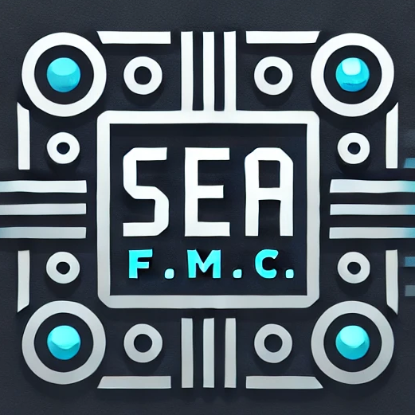
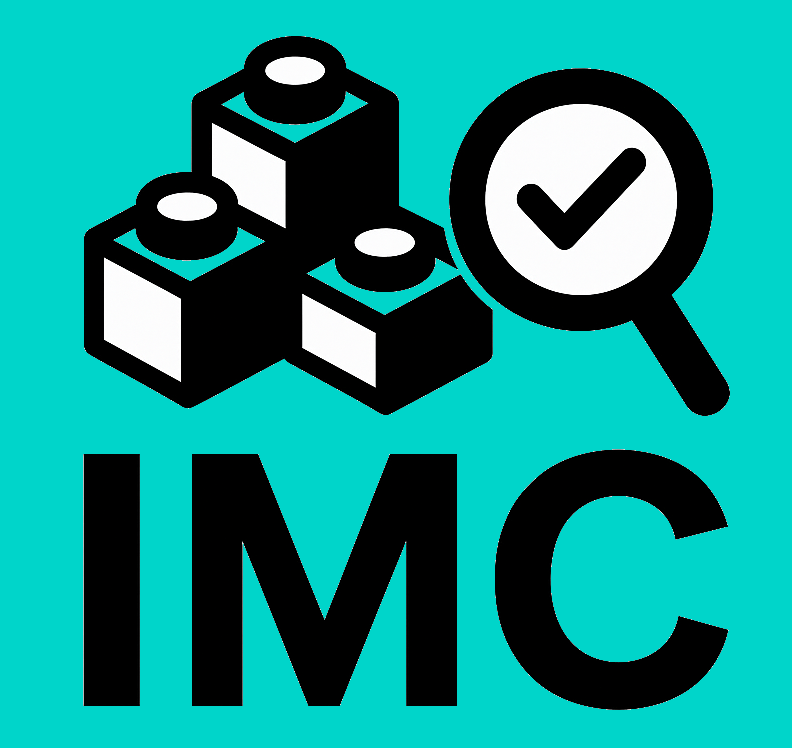

<!-- Slide number: 1 -->
# Modularization Evaluation [CRA FEATURE xyz]
2026-xx-yy
V0.1
SFO: …
ARC: …

### Notes:

<!-- Slide number: 2 -->
# Abstract
…

Page 2
Restricted | © Siemens 2026 | [SFO] | 2026-xx-yy

### Notes:

<!-- Slide number: 3 -->
# Questions to answer
Which framework currently has which solution?
…
How does the mid/long term solution look like?
…
What modularization activities are planned to reduce the number of solutions and therefore mid/long term effort?
…
What is the next migration step in each framework or product towards mid/long term solution? State reasons?
…
Page 3
Restricted | © Siemens 2026 | [SFO] | 2026-xx-yy

### Notes:

<!-- Slide number: 4 -->
# Overview
Seite 4
Restricted | © Siemens 2026 | [SFO] | 2026-xx-yy

<!-- Slide number: 5 -->
# Contents
FMC – Firmware Modularization Council
Evaluation of modular firmware solutions
Agreement level of product teams affected to use proposed solutions
IMC – Integration Test Modularization Council
Creation of test case set for products affected based on test concept
Evaluation of test automation solutions including CBU (cost-benefit-urgency evaluation)
Agreement level of product teams affected to use both proposed test cases and test automation solutions
Page 5
Restricted | © Siemens 2026 | [SFO] | 2026-xx-yy

### Notes:

<!-- Slide number: 6 -->
# FMC – Firmware Modularization Council
Evaluation of modular firmware solutions
Agreement level of product teams affected to use proposed solutions

Page 6
Restricted | © Siemens 2026 | [SFO] | 2026-xx-yy

### Notes:

<!-- Slide number: 7 -->
# Development and integration tasks
Page 7
Restricted | © Siemens 2026 | [SFO] | 2026-xx-yy

### Notes:

<!-- Slide number: 8 -->
# Development and integration time schedule

C
R
A
SEA-Frameworks
Now
10/2025
Product Release CRA
2026

…
	[2025-07-08]
IMCK
	[2025-06-18]

IO-Framework
(ET 200MP)	[2025-07-01]

SP BaSy
(ET 200SP)	[2025-06-16]

Failsafe IO
	[2025-06-27]

Technology IO
	[2025-06-13]

AL BaSy
(ET 200AL)	[2025-06-16]

TPS1 Framework
(ET 200ecoPN / clean) [2025-06-16]

PeSy
(ET 200pro)	[2025-06-16]
Page 8
Restricted | © Siemens 2026 | [SFO] | 2026-xx-yy

### Notes:

<!-- Slide number: 9 -->
# Logging of Security Events @ IMCK
Status 2026-xx-yy - Sync with …
Decisions
…
Roadmap (temporary)
…
Next steps
...

Page 9
Restricted | © Siemens 2026 | [SFO] | 2026-xx-yy

### Notes:

<!-- Slide number: 10 -->
# Logging of Security Events @ IO-Framework (ET 200MP)
Status 2026-xx-yy - Sync with …
Decisions
…
Roadmap (temporary)
…
Next steps
...

Page 10
Restricted | © Siemens 2026 | [SFO] | 2026-xx-yy

### Notes:

<!-- Slide number: 11 -->
# Logging of Security Events @ SP BaSy (ET 200SP)
Status 2026-xx-yy - Sync with …
Decisions
…
Roadmap (temporary)
…
Next steps
...

Page 11
Restricted | © Siemens 2026 | [SFO] | 2026-xx-yy

### Notes:

<!-- Slide number: 12 -->
# Logging of Security Events @ Failsafe IO
Status 2026-xx-yy - Sync with …
Decisions
…
Roadmap (temporary)
…
Next steps
...

Page 12
Restricted | © Siemens 2026 | [SFO] | 2026-xx-yy

### Notes:

<!-- Slide number: 13 -->
# Logging of Security Events @ TL
Status 2026-xx-yy - Sync with …
Decisions
…
Roadmap (temporary)
…
Next steps
...

Page 13
Restricted | © Siemens 2026 | [SFO] | 2026-xx-yy

### Notes:

<!-- Slide number: 14 -->
# Logging of Security Events @ AL BaSy (ET 200AL)
Status 2026-xx-yy - Sync with …
Decisions
…
Roadmap (temporary)
…
Next steps
...

Page 14
Restricted | © Siemens 2026 | [SFO] | 2026-xx-yy

### Notes:

<!-- Slide number: 15 -->
# Logging of Security Events @ TPS1 Framework (ET 200ecoPN / ET 200clean)
Status 2026-xx-yy - Sync with …
Decisions
…
Roadmap (temporary)
…
Next steps
...

Page 15
Restricted | © Siemens 2026 | [SFO] | 2026-xx-yy

### Notes:

<!-- Slide number: 16 -->
# Logging of Security Events @ PESY (ET 200Pro)
Status 2026-xx-yy - Sync with …
Decisions
…
Roadmap (temporary)
…
Next steps
...

Page 16
Restricted | © Siemens 2026 | [SFO] | 2026-xx-yy

### Notes:

<!-- Slide number: 17 -->
# IMC – Integration Test Modularization Council
Creation of test case set for products affected based on test concept
Evaluation of test automation solutions including CBU (cost-benefit-urgency evaluation)
Agreement level of product teams affected to use both proposed test cases and test automation solutions

Page 17
Restricted | © Siemens 2026 | [SFO] | 2026-xx-yy

### Notes:

<!-- Slide number: 18 -->
# Test Overview
AS IO ListOfTesters  IMC-Membership added, so you can synch with them to get for all their product groups their commitment or not and why to use test cases created and test automation created and test automation to be created.
Overview of General Development Test and Integration Test Case Creation
...
Overview of General Development Test and Integration Test Automation Evaluation
...

Page 18
Restricted | © Siemens 2026 | [SFO] | 2026-xx-yy

### Notes:

<!-- Slide number: 19 -->
# Creation of test case set for products affected based on test concept
…
Page 19
Restricted | © Siemens 2026 | [SFO] | 2026-xx-yy

### Notes:

<!-- Slide number: 20 -->
# Test automation solutions
Describe the intended solution for the automation of tests …
Page 20
Restricted | © Siemens 2026 | [SFO] | 2026-xx-yy

### Notes:

<!-- Slide number: 21 -->
# Required functionality from automation frameworks
| Automation function | Automation task | TAF | MoTIF |
| --- | --- | --- | --- |
| What is required | What needs to be done | available and usable as is available but needs adaption / extension not available and must be implemented | available and usable as is available but needs adaption / extension not available and must be implemented |
| … |  |  |  |
|  |  |  |  |
Page 21
Restricted | © Siemens 2026 | [SFO] | 2026-xx-yy

### Notes:

<!-- Slide number: 22 -->
# Cost benefit urgency scores
| Automation function | Result | TAF | MoTIF |
| --- | --- | --- | --- |
| What is required | Module Package Extensions Tool | Score | score |
| … |  |  |  |
|  |  |  |  |
Give a recommonendation for each automation function and reasoning backed up with the CBU score …
Page 22
Restricted | © Siemens 2026 | [SFO] | 2026-xx-yy

### Notes:

<!-- Slide number: 23 -->
# IMC member Dirk Gloeckner representing Product Group of IOD IM in CHE
Agreement to use proposed generic test cases
…
Agreement to use proposed existing test automation solutions
…
Agreement to use proposed to be created test automation solutions
…

Page 23
Restricted | © Siemens 2026 | [SFO] | 2026-xx-yy

### Notes:

<!-- Slide number: 24 -->
# IMC member Cornelius Faust representing Product Group of IOD IO in CHE
Agreement to use proposed generic test cases
…
Agreement to use proposed existing test automation solutions
…
Agreement to use proposed to be created test automation solutions
…

Page 24
Restricted | © Siemens 2026 | [SFO] | 2026-xx-yy

### Notes:

<!-- Slide number: 25 -->
# IMC member Florian Tomas representing Product Group of IOD IM, IO in PRG, BRN
Agreement to use proposed generic test cases
…
Agreement to use proposed existing test automation solutions
…
Agreement to use proposed to be created test automation solutions
…

Page 25
Restricted | © Siemens 2026 | [SFO] | 2026-xx-yy

### Notes:

<!-- Slide number: 26 -->
# IMC member Tom Zieschank representing Product Group of IOO compact in CHE
Agreement to use proposed generic test cases
…
Agreement to use proposed existing test automation solutions
…
Agreement to use proposed to be created test automation solutions
…

Page 26
Restricted | © Siemens 2026 | [SFO] | 2026-xx-yy

### Notes:

<!-- Slide number: 27 -->
# IMC member Alexander Zhigunov representing Product Group of IOO IM, IO, compact in PRG
Agreement to use proposed generic test cases
…
Agreement to use proposed existing test automation solutions
…
Agreement to use proposed to be created test automation solutions
…

Page 27
Restricted | © Siemens 2026 | [SFO] | 2026-xx-yy

### Notes:

<!-- Slide number: 28 -->
# IMC member Christopher Kueppers representing Product Group of IOC IM in AMB
Agreement to use proposed generic test cases
…
Agreement to use proposed existing test automation solutions
…
Agreement to use proposed to be created test automation solutions
…

Page 28
Restricted | © Siemens 2026 | [SFO] | 2026-xx-yy

### Notes:

<!-- Slide number: 29 -->
# IMC member Christoph Gubisch representing Product Group of IOC IO in AMB
Agreement to use proposed generic test cases
…
Agreement to use proposed existing test automation solutions
…
Agreement to use proposed to be created test automation solutions
…

Page 29
Restricted | © Siemens 2026 | [SFO] | 2026-xx-yy

### Notes:

<!-- Slide number: 30 -->
# IMC member Lorenz Wallner representing Product Group of TL IO in FTH
Agreement to use proposed generic test cases
…
Agreement to use proposed existing test automation solutions
…
Agreement to use proposed to be created test automation solutions
…

Page 30
Restricted | © Siemens 2026 | [SFO] | 2026-xx-yy

### Notes:

<!-- Slide number: 31 -->
# IMC member Thomas Roeckl representing Product Group of SAFI IO in AMB
Agreement to use proposed generic test cases
…
Agreement to use proposed existing test automation solutions
…
Agreement to use proposed to be created test automation solutions
…

Page 31
Restricted | © Siemens 2026 | [SFO] | 2026-xx-yy

### Notes:

<!-- Slide number: 32 -->
# Change history
| Version | Date | Author | Changes |
| --- | --- | --- | --- |
| V0.1 | 2026-01-28 | Thorsten Drogge | Extended FMC modularization outlook with IMC |
|  |  |  |  |
Page 32
Restricted | © Siemens 2026 | [SFO] | 2026-xx-yy

### Notes:

<!-- Slide number: 33 -->
# Frameworks / Construction kits / Products usage by Business lines for CRA
 SEA
IOC
IOD
IOO
TL
SAFI
IMCK

IO-Framework
(ET 200MP)

SP BaSy
(ET 200SP)
Failsafe IO

Technology IO

AL BaSy
(ET 200AL)

TPS1 Framework
(ET 200ecoPN / clean)

PeSy
(ET 200pro)

Page 33
Restricted | © Siemens 2026 | [SFO] | 2026-xx-yy

### Notes: